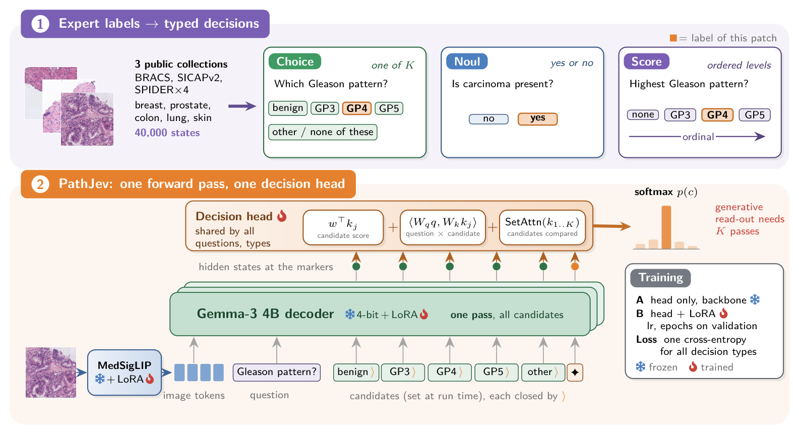
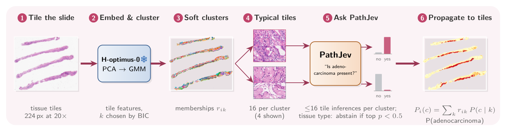
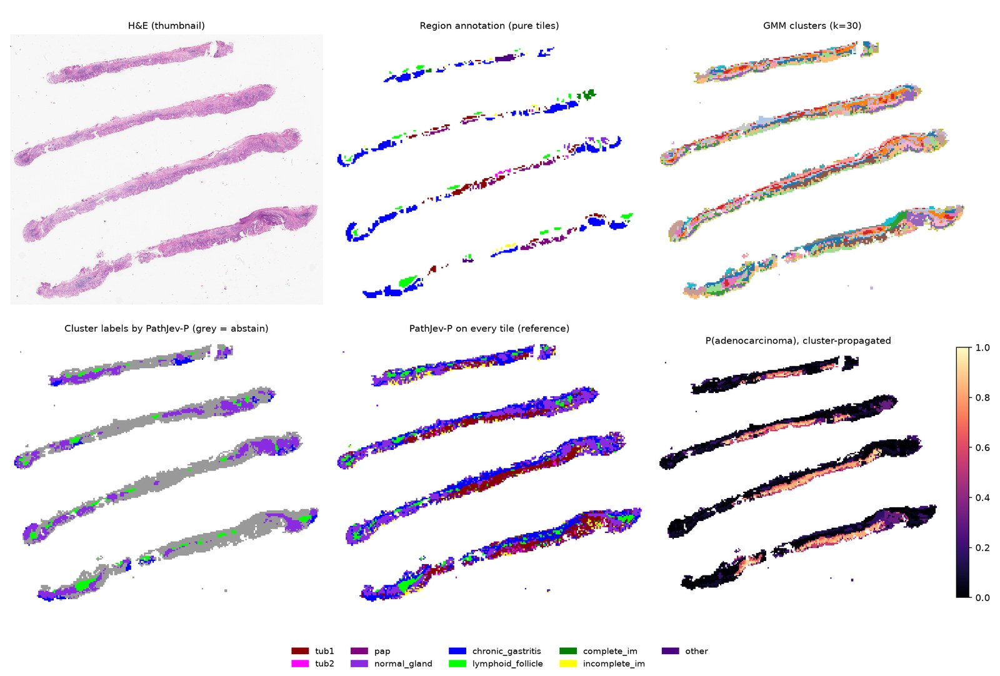

# PathJev: decision-native vision–language modelling for histopathology

[](https://arxiv.org/abs/2610.32478)
[](https://huggingface.co/Cristiandieti/PathJev-P)
[](https://huggingface.co/spaces/Cristiandieti/PathJev-P-demo)
[](https://colab.research.google.com/github/CosmoIknosLab/PathJev/blob/main/inference/PathJev_demo.ipynb)
[](LICENSE)

PathJev is a decision-native vision–language model for histopathology. Given an image, a question and a set of
candidate answers chosen at run time, it returns a normalised probability distribution over the candidates,
including "none of these", in a single forward pass. It handles three question types: one of K classes (Choice), yes
or no (Noul) and ordered levels (Score). The model is MedGemma-1.5-4B with LoRA adapters and a decision head that
reads the hidden states at marker tokens closing each candidate. Training data are built deterministically from
expert pathology annotations, with organ-specific candidate sets and whole organs held out for testing.

<p align="center"></p>

This repository contains the code to build the training and test data, train PathJev-P and the generative baseline,
evaluate all methods, run the whole-slide cluster-labelling pipeline, and regenerate every table, figure and number
of the paper.

- **Paper:** Cristian Tommasino and Antonio M. Rinaldi, *PathJev: Decision-Native Vision–Language Modelling for
  Histopathology*, [arXiv:2610.32478](https://arxiv.org/abs/2610.32478), 2026.
- **Code:** https://github.com/CosmoIknosLab/PathJev (this repository).
- **Model weights:** https://huggingface.co/Cristiandieti/PathJev-P (non-commercial research use; MedGemma HAI-DEF
  terms).
- **Demo:** https://huggingface.co/spaces/Cristiandieti/PathJev-P-demo (precomputed examples). The model repository
  also has a Colab notebook for live use on a free GPU.

Not intended or validated for clinical use.


## Quick start: use the trained model

The trained PathJev-P weights (LoRA adapter and decision head) are on Hugging Face, at
[Cristiandieti/PathJev-P](https://huggingface.co/Cristiandieti/PathJev-P). You need access to the base model
`google/medgemma-1.5-4b-it`: accept its terms on Hugging Face and log in with `huggingface-cli login`. To try it
without installing anything, open the [Colab notebook](https://colab.research.google.com/github/CosmoIknosLab/PathJev/blob/main/inference/PathJev_demo.ipynb),
which runs on a free GPU.

```python
# pip install "transformers>=4.50" peft bitsandbytes accelerate pillow huggingface_hub   (4-bit needs a CUDA GPU)
import sys
from huggingface_hub import snapshot_download
local = snapshot_download("Cristiandieti/PathJev-P")      # weights + inference code
sys.path.insert(0, local)
from pathjev_infer import PathJev

model = PathJev.load(local, token=True)
probs = model.predict("patch.png", [{
    "instructions": "Which Gleason pattern predominates in this prostate tissue?",
    "candidates": [{"id": "benign", "text": "benign (non-cancerous) prostate tissue"},
                   {"id": "gp3", "text": "Gleason pattern 3 carcinoma"},
                   {"id": "gp4", "text": "Gleason pattern 4 carcinoma"},
                   {"id": "gp5", "text": "Gleason pattern 5 carcinoma"}]}], add_other=True)
print(probs[0])   # one probability per candidate, plus "other"
```

The same inference code is in [`inference/pathjev_infer/`](inference/pathjev_infer/). The weights are for
non-commercial research use under the MedGemma (HAI-DEF) terms, and they are not intended for clinical use.

## Whole-slide use

PathJev can name tissue clusters in a whole slide. Tiles are embedded with H-optimus-0 and grouped by a Gaussian
mixture with soft memberships; PathJev-P is run on the most typical tiles of each cluster, abstains when unsure, and
cluster probabilities are propagated back to every tile.

<p align="center"></p>

The example below is a gastric slide from HiESD, an organ never seen in training. It shows, from top left: the
thumbnail, the region annotation, the clusters, the cluster labels (grey: abstain), PathJev-P on every tile, and the
adenocarcinoma probability propagated from the clusters. This is a qualitative demonstration on four slides. The
fine-grained gastric classes are mostly not recognised, while the coarse question "is adenocarcinoma present?" is
answered well (see the paper).

<p align="center"></p>

<sub>Images: SICAPv2 (Silva-Rodríguez et al., 2020) and HiESD (Ge et al., 2025), both CC BY 4.0.</sub>

## Repository layout

| Path | Content |
|---|---|
| `src/pathjev/` | data sources, records, splits, decision templates, states, mixes, evaluation sets, metrics, statistics, generative baseline, baselines, WSI demo |
| `src/data/`, `src/phase0/` | dataset download and extraction helpers; reproduction of a published OmniMed-Jev number |
| `src/shims/` | minimal stand-in for an upstream dependency |
| `configs/` | source builds, decision templates (`questions/`), training mixes, evaluation sets, WSI demo |
| `data/manifests/` | patient- or slide-level split manifests, the HiESD slide→patient map, test-set exclusions |
| `data/registry.csv` | dataset registry: version or DOI, licence, access, cohorts, overlaps, role |
| `analysis/` | analysis, statistics, tables, figures and LaTeX macros of the paper |
| `slurm/` | job scripts used for the experiments (see `slurm/README.md`) |
| `inference/pathjev_infer/` | minimal inference package used by the model card and the demo |
| `results/runs/*/` | small JSON summaries of the final analyses (no predictions, no weights) |
| `docs/` | the analysis plan and the rule that rebuilds each of its versions |
| `tests/` | unit tests |

## Installation

Python 3.11 on Linux with a CUDA GPU (the experiments used H100 80 GB).

```bash
python3.11 -m venv .venv && source .venv/bin/activate
pip install -r requirements.lock

# Upstream OmniMed-Jev (training and inference scripts), pinned, with a Python 3.11 patch
git clone https://github.com/lytang63/OmniMed-Jev external/OmniMed-Jev
git -C external/OmniMed-Jev checkout 68be52a3f99d93b08079baf774eb09280b144be7
git -C external/OmniMed-Jev apply ../../external_patches/omnimedjev-py311-fstrings.patch

export PYTHONPATH=$PWD/src/shims:$PWD/src:$PWD/external/OmniMed-Jev
export PATHJEV_DATA=$HOME/pathjev/data     # raw datasets
export PATHJEV_WORK=$HOME/pathjev/work     # states, checkpoints, predictions (about 1 TB in total)
```

Base models are downloaded from Hugging Face: `google/medgemma-1.5-4b-it` (gated, accept its terms),
`xmutly/OmniMed-Jev-4B`, `MahmoodLab/conch` (gated) and `bioptimus/H-optimus-0` (gated).

## Data

No dataset is redistributed. Each dataset must be obtained from its source under its own licence and access
conditions, which are listed in `data/registry.csv`. The paper uses SPIDER (four organs), BRACS, SICAPv2,
HepatoBench and HiESD. Several of them are licensed for non-commercial research only, and some require registration.
Building the states is deterministic: rebuilding must reproduce the manifests byte for byte
(`data/manifests/EXPECTED.sha256`).

```bash
# one source at a time (CPU); configs/build/<source>.yaml
python -m pathjev.build --config configs/build/bracs.yaml
# training mix and evaluation sets of Stage 1
python -m pathjev.mix --config configs/train/stage1-p.yaml
python -m pathjev.evalsets --config configs/eval/stage1-test.yaml
python -m pathjev.evalsets --config configs/eval/stage1-test-full.yaml
```

## Training and evaluation

The experiments ran as Slurm job chains; `slurm/README.md` explains how to adapt them to another cluster.

```bash
source slurm/cluster.env
slurm/campaigns/stage1_phase4.sh prep                       # mix and evaluation sets
slurm/campaigns/stage1_phase4.sh grid                       # lr x epochs grid, PathJev-P and generative SFT, seed 1
python analysis/select_config.py --work $PATHJEV_WORK --arm jev --runs <grid runs> --out results/runs/stage1-config/jev.json
slurm/campaigns/stage1_phase4.sh seeds <jev-run> <sft-run>   # seeds 2 and 3 of the selected configurations, then test
```

Single jobs: `train_jev.sbatch` (two-stage PathJev training), `train_sft.sbatch` (generative baseline),
`post_train.sbatch` (checkpoint selection on validation, then test), `eval_arm.sbatch` (score any method on a set of
state files), `baseline.sbatch` (CONCH, H-optimus-0 features and probe, Inner-Jev read-out) and `wsi_demo.sbatch`
(whole-slide cluster labelling). Each script documents its variables in its header.

The analysis plan, with hypotheses, endpoints, tests and amendments, is `docs/stage1_analysis_plan.md`.
`docs/stage1_plan_versions.md` gives the hash of each version and the rule that rebuilds it from the file.

## Regenerating the paper's tables, figures and numbers

Without data or GPUs, from the JSON summaries in `results/runs/`:

```bash
python analysis/paper_tables.py --analysis results/runs/stage1-analysis/summary.json \
    --temperature results/runs/stage1-temperature/summary.json --out paper/generated   # main, temperature, per-set, full-file, scaled tables
python analysis/a3_macros.py                                                           # post-hoc robustness macros
PYTHONPATH=src:analysis python analysis/a3_checks.py --out results/runs/stage1-a3 --tables paper/generated --tables-only
python analysis/a3_hepato.py --out results/runs/stage1-a3-hepato --table-only
```

With the built states and the saved predictions in `$PATHJEV_WORK`:

```bash
python analysis/stage1_analysis.py --work $PATHJEV_WORK --out results/runs/stage1-analysis --resamples 10000
python analysis/stage1_temperature_transfer.py --work $PATHJEV_WORK --out results/runs/stage1-temperature
python analysis/export_macros.py --work $PATHJEV_WORK --out paper/generated/numbers.tex \
    --analysis results/runs/stage1-analysis/summary.json --temperature results/runs/stage1-temperature/summary.json
python analysis/paper_tables.py --analysis results/runs/stage1-analysis/summary.json \
    --temperature results/runs/stage1-temperature/summary.json --wsi $PATHJEV_WORK/wsi_demo/demo-hiesd --out paper/generated
python analysis/data_statement.py --work $PATHJEV_WORK          # data statement and test-set table
python analysis/training_details.py --work $PATHJEV_WORK        # training budget table
python analysis/secondary_metrics.py --work $PATHJEV_WORK       # secondary metrics
PYTHONPATH=src python analysis/noul_score.py --work $PATHJEV_WORK
python analysis/reliability.py --work $PATHJEV_WORK --out paper/figures/reliability.pdf
python analysis/a3_hepato.py --work $PATHJEV_WORK --out results/runs/stage1-a3-hepato
PYTHONPATH=src:analysis python analysis/a3_checks.py --work $PATHJEV_WORK --out results/runs/stage1-a3 --tables paper/generated
python analysis/audit_selection.py --work $PATHJEV_WORK > results/runs/stage1-audits/selection.json
python analysis/audit_rerun.py --work $PATHJEV_WORK > results/runs/stage1-audits/rerun.json
python analysis/audit_macros.py --work $PATHJEV_WORK
python analysis/dedup_audit.py --work $PATHJEV_WORK --out results/runs/stage1-dedup
python analysis/figure_assets.py --work $PATHJEV_WORK --slide 46e7dccd-521a-4d0f-80bd-10e960cd5905 --out paper/figures/overview
```

## Tests

```bash
PYTHONPATH=src:analysis python -m pytest -q tests
```

Some tests are skipped when the built states are not available.

## Notes

Code comments refer to decision identifiers (D-001, D-002, …) and to the project log of the original working
repository. That log is not part of this release; the analysis plan is.

## Citation

```bibtex
@misc{tommasino2026pathjev,
  title         = {PathJev: Decision-Native Vision--Language Modelling for Histopathology},
  author        = {Tommasino, Cristian and Rinaldi, Antonio M.},
  year          = {2026},
  eprint        = {2610.32478},
  archivePrefix = {arXiv},
  primaryClass  = {cs.CV},
  doi           = {10.48550/arXiv.2610.32478},
  url           = {https://arxiv.org/abs/2610.32478}
}
```

Please also cite OmniMed-Jev, MedGemma and the datasets you use.

## Licence

The code is released under the Apache License 2.0 (`LICENSE`); `NOTICE` lists third-party code. The model weights are
not part of this repository and carry their own licence: they are a MedGemma derivative under the Health AI Developer
Foundations terms and are for non-commercial research only.
